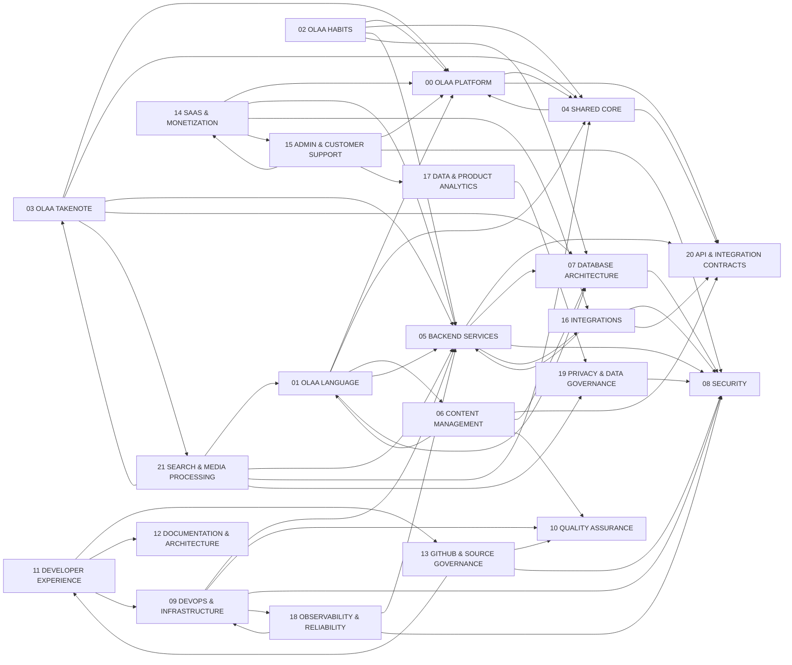

# Dependency Map

Nhánh nào phụ thuộc nhánh nào, ở mức nào và qua interface nào. Nguồn ban đầu: cột "Phụ thuộc chính" trong `OLAA_MASTER_ARCHITECTURE.md`, mục 5.

**Mức phụ thuộc**
- `Thiết kế` — đã xác định trong kiến trúc, chưa có interface.
- `Interface` — đã có contract hoặc package được phê duyệt.
- `Runtime` — đang được gọi trong mã nguồn đã triển khai.

**Trạng thái interface**
- `PENDING` — chưa có contract; nhánh phụ thuộc phải đề xuất interface tối thiểu, không tự xây nhánh kia.
- `PROPOSED` — đã có đề xuất, chờ duyệt.
- `APPROVED` — contract được phê duyệt, ghi đường dẫn trong cột Interface.

**Quy tắc**
- Phụ thuộc chỉ đi qua contract (`olaa-platform/contracts/`), package Shared Core đã phát hành, hoặc domain event. Không truy cập database hay mã nội bộ của nhánh khác.
- Repository app (`olaa-language`, `olaa-habits`, `olaa-takenote`) không phụ thuộc lẫn nhau trực tiếp.
- Mỗi thay đổi bảng này ghi vào `INTEGRATION_CHANGELOG.md`.

## Bảng phụ thuộc

| Nhánh | Phụ thuộc vào | Mức | Interface | Trạng thái |
|---|---|---|---|---|
| 00 OLAA PLATFORM | 04 SHARED CORE | Thiết kế | Chưa định nghĩa | PENDING |
| 00 OLAA PLATFORM | 20 API & INTEGRATION CONTRACTS | Thiết kế | Chưa định nghĩa | PENDING |
| 01 OLAA LANGUAGE | 00 OLAA PLATFORM | Thiết kế | Chưa định nghĩa | PENDING |
| 01 OLAA LANGUAGE | 04 SHARED CORE | Thiết kế | Chưa định nghĩa | PENDING |
| 01 OLAA LANGUAGE | 06 CONTENT MANAGEMENT | Thiết kế | Chưa định nghĩa | PENDING |
| 01 OLAA LANGUAGE | 05 BACKEND SERVICES | Thiết kế | Chưa định nghĩa | PENDING |
| 01 OLAA LANGUAGE | 07 DATABASE ARCHITECTURE | Thiết kế | Chưa định nghĩa | PENDING |
| 02 OLAA HABITS | 00 OLAA PLATFORM | Thiết kế | Chưa định nghĩa | PENDING |
| 02 OLAA HABITS | 04 SHARED CORE | Thiết kế | Chưa định nghĩa | PENDING |
| 02 OLAA HABITS | 05 BACKEND SERVICES | Thiết kế | Chưa định nghĩa | PENDING |
| 02 OLAA HABITS | 07 DATABASE ARCHITECTURE | Thiết kế | Chưa định nghĩa | PENDING |
| 03 OLAA TAKENOTE | 00 OLAA PLATFORM | Thiết kế | Chưa định nghĩa | PENDING |
| 03 OLAA TAKENOTE | 04 SHARED CORE | Thiết kế | Chưa định nghĩa | PENDING |
| 03 OLAA TAKENOTE | 05 BACKEND SERVICES | Thiết kế | Chưa định nghĩa | PENDING |
| 03 OLAA TAKENOTE | 07 DATABASE ARCHITECTURE | Thiết kế | Chưa định nghĩa | PENDING |
| 03 OLAA TAKENOTE | 21 SEARCH & MEDIA PROCESSING | Thiết kế | Chưa định nghĩa | PENDING |
| 04 SHARED CORE | 00 OLAA PLATFORM | Thiết kế | Chưa định nghĩa | PENDING |
| 04 SHARED CORE | 20 API & INTEGRATION CONTRACTS | Thiết kế | Chưa định nghĩa | PENDING |
| 05 BACKEND SERVICES | 20 API & INTEGRATION CONTRACTS | Thiết kế | Chưa định nghĩa | PENDING |
| 05 BACKEND SERVICES | 07 DATABASE ARCHITECTURE | Thiết kế | Chưa định nghĩa | PENDING |
| 05 BACKEND SERVICES | 08 SECURITY | Thiết kế | Chưa định nghĩa | PENDING |
| 05 BACKEND SERVICES | 16 INTEGRATIONS | Thiết kế | Chưa định nghĩa | PENDING |
| 06 CONTENT MANAGEMENT | 01 OLAA LANGUAGE | Thiết kế | Chưa định nghĩa | PENDING |
| 06 CONTENT MANAGEMENT | 20 API & INTEGRATION CONTRACTS | Thiết kế | Chưa định nghĩa | PENDING |
| 06 CONTENT MANAGEMENT | 07 DATABASE ARCHITECTURE | Thiết kế | Chưa định nghĩa | PENDING |
| 06 CONTENT MANAGEMENT | 10 QUALITY ASSURANCE | Thiết kế | Chưa định nghĩa | PENDING |
| 07 DATABASE ARCHITECTURE | 08 SECURITY | Thiết kế | Chưa định nghĩa | PENDING |
| 09 DEVOPS & INFRASTRUCTURE | 05 BACKEND SERVICES | Thiết kế | Chưa định nghĩa | PENDING |
| 09 DEVOPS & INFRASTRUCTURE | 10 QUALITY ASSURANCE | Thiết kế | Chưa định nghĩa | PENDING |
| 09 DEVOPS & INFRASTRUCTURE | 08 SECURITY | Thiết kế | Chưa định nghĩa | PENDING |
| 09 DEVOPS & INFRASTRUCTURE | 18 OBSERVABILITY & RELIABILITY | Thiết kế | Chưa định nghĩa | PENDING |
| 11 DEVELOPER EXPERIENCE | 13 GITHUB & SOURCE GOVERNANCE | Thiết kế | Chưa định nghĩa | PENDING |
| 11 DEVELOPER EXPERIENCE | 12 DOCUMENTATION & ARCHITECTURE | Thiết kế | Chưa định nghĩa | PENDING |
| 11 DEVELOPER EXPERIENCE | 09 DEVOPS & INFRASTRUCTURE | Thiết kế | Chưa định nghĩa | PENDING |
| 13 GITHUB & SOURCE GOVERNANCE | 11 DEVELOPER EXPERIENCE | Thiết kế | Chưa định nghĩa | PENDING |
| 13 GITHUB & SOURCE GOVERNANCE | 10 QUALITY ASSURANCE | Thiết kế | Chưa định nghĩa | PENDING |
| 13 GITHUB & SOURCE GOVERNANCE | 08 SECURITY | Thiết kế | Chưa định nghĩa | PENDING |
| 14 SAAS & MONETIZATION | 00 OLAA PLATFORM | Thiết kế | Chưa định nghĩa | PENDING |
| 14 SAAS & MONETIZATION | 05 BACKEND SERVICES | Thiết kế | Chưa định nghĩa | PENDING |
| 14 SAAS & MONETIZATION | 16 INTEGRATIONS | Thiết kế | Chưa định nghĩa | PENDING |
| 14 SAAS & MONETIZATION | 15 ADMIN & CUSTOMER SUPPORT | Thiết kế | Chưa định nghĩa | PENDING |
| 15 ADMIN & CUSTOMER SUPPORT | 00 OLAA PLATFORM | Thiết kế | Chưa định nghĩa | PENDING |
| 15 ADMIN & CUSTOMER SUPPORT | 14 SAAS & MONETIZATION | Thiết kế | Chưa định nghĩa | PENDING |
| 15 ADMIN & CUSTOMER SUPPORT | 08 SECURITY | Thiết kế | Chưa định nghĩa | PENDING |
| 15 ADMIN & CUSTOMER SUPPORT | 17 DATA & PRODUCT ANALYTICS | Thiết kế | Chưa định nghĩa | PENDING |
| 16 INTEGRATIONS | 05 BACKEND SERVICES | Thiết kế | Chưa định nghĩa | PENDING |
| 16 INTEGRATIONS | 08 SECURITY | Thiết kế | Chưa định nghĩa | PENDING |
| 16 INTEGRATIONS | 20 API & INTEGRATION CONTRACTS | Thiết kế | Chưa định nghĩa | PENDING |
| 17 DATA & PRODUCT ANALYTICS | 19 PRIVACY & DATA GOVERNANCE | Thiết kế | Chưa định nghĩa | PENDING |
| 18 OBSERVABILITY & RELIABILITY | 05 BACKEND SERVICES | Thiết kế | Chưa định nghĩa | PENDING |
| 18 OBSERVABILITY & RELIABILITY | 09 DEVOPS & INFRASTRUCTURE | Thiết kế | Chưa định nghĩa | PENDING |
| 18 OBSERVABILITY & RELIABILITY | 08 SECURITY | Thiết kế | Chưa định nghĩa | PENDING |
| 19 PRIVACY & DATA GOVERNANCE | 08 SECURITY | Thiết kế | Chưa định nghĩa | PENDING |
| 21 SEARCH & MEDIA PROCESSING | 03 OLAA TAKENOTE | Thiết kế | Chưa định nghĩa | PENDING |
| 21 SEARCH & MEDIA PROCESSING | 01 OLAA LANGUAGE | Thiết kế | Chưa định nghĩa | PENDING |
| 21 SEARCH & MEDIA PROCESSING | 05 BACKEND SERVICES | Thiết kế | Chưa định nghĩa | PENDING |
| 21 SEARCH & MEDIA PROCESSING | 04 SHARED CORE | Thiết kế | Chưa định nghĩa | PENDING |
| 21 SEARCH & MEDIA PROCESSING | 19 PRIVACY & DATA GOVERNANCE | Thiết kế | Chưa định nghĩa | PENDING |

## Phụ thuộc xuyên suốt

Các nhánh có phụ thuộc tới mọi domain (không liệt kê từng cạnh):

| Nhánh | Phạm vi |
|---|---|
| 07 DATABASE ARCHITECTURE | All domain owners |
| 08 SECURITY | All branches |
| 10 QUALITY ASSURANCE | All apps/services |
| 12 DOCUMENTATION & ARCHITECTURE | All branches |
| 17 DATA & PRODUCT ANALYTICS | All product domains |
| 19 PRIVACY & DATA GOVERNANCE | All domains, Legal |
| 20 API & INTEGRATION CONTRACTS | All app and service owners |

## Sơ đồ

